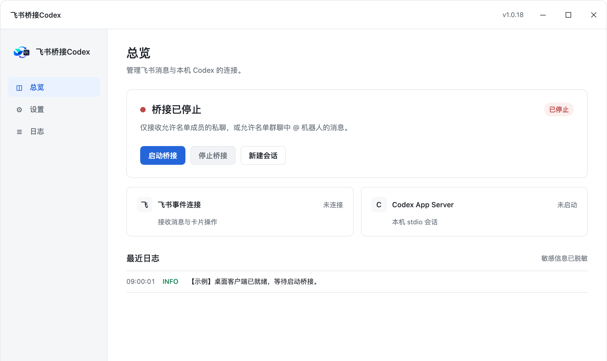
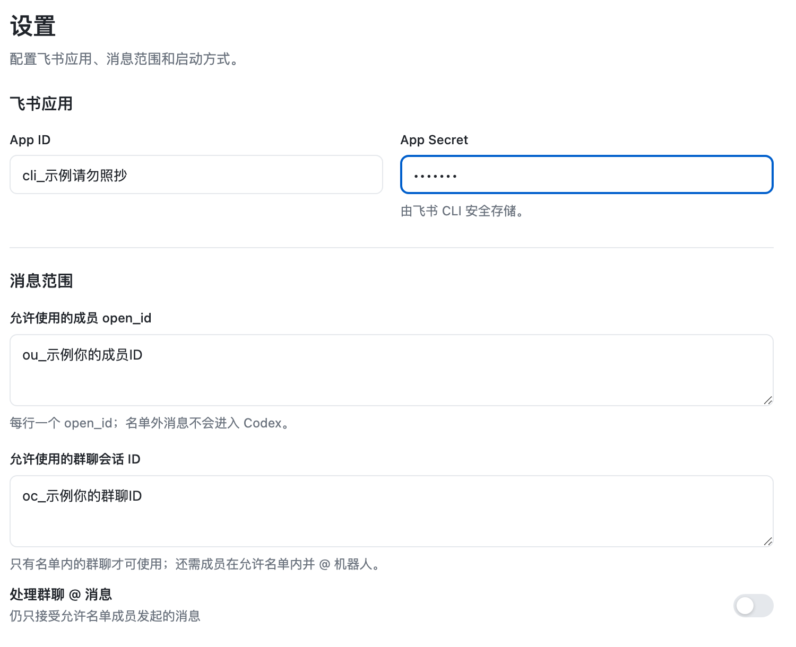
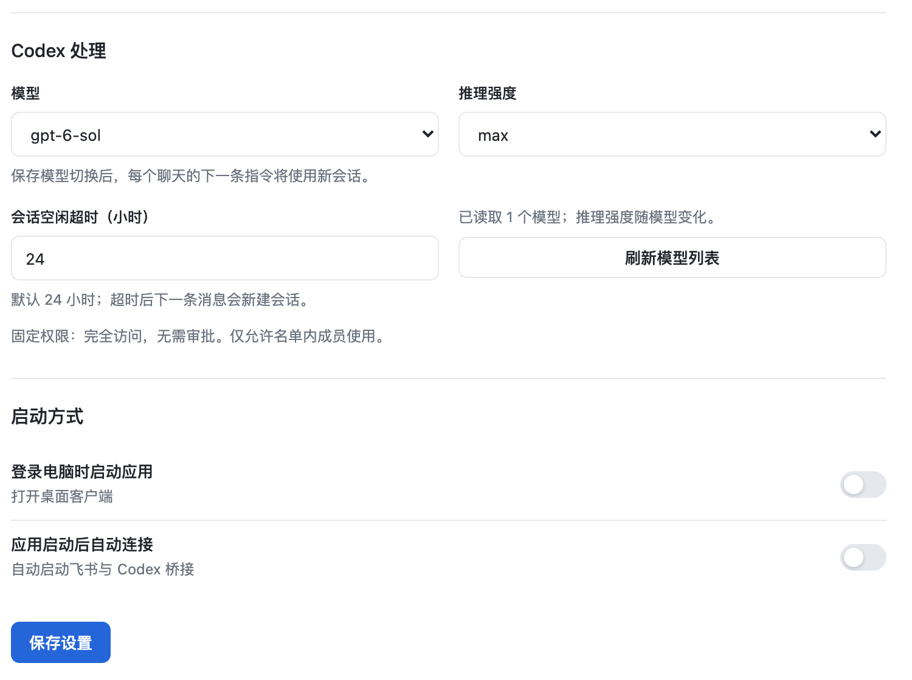
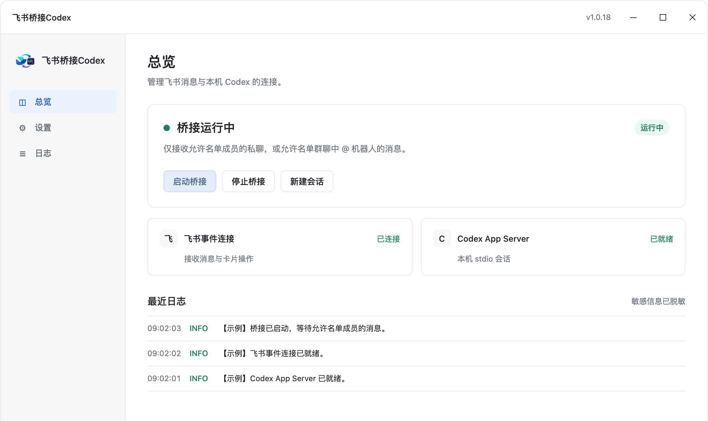
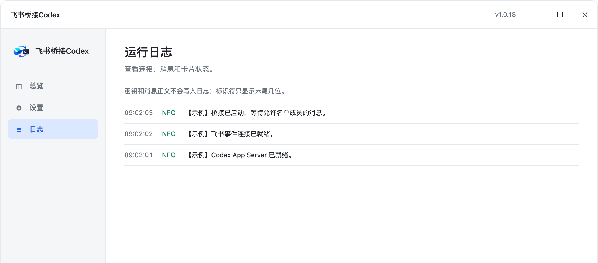

# 飞书桥接 Codex 使用说明（Windows 版）

## 1. 前言

1. 这个工具可以把飞书消息交给你 Windows 电脑上的 Codex 处理，再把回复发回飞书。电脑端、手机端飞书都能用。
2. **目的是让你在飞书里直接使用本机 Codex，处理文件、图片和日常任务。**
3. **日常使用只需要给机器人发消息。**第一次按下面顺序完成配置；飞书后台部分也可以请应用管理员协助。

**软件包：**

（Windows 安装包由文档维护者粘贴在这里）

## 2. 开始前，先准备好 3 件事

- [ ] 电脑是 Windows 10 或 Windows 11，64 位（x64），并且能联网。
- [ ] 同一个 Windows 用户下，Codex 已登录并能正常使用。桥接工具沿用本机 Codex 登录状态，工具内没有登录按钮。
- [ ] 有可用的飞书账号，以及一个企业自建应用机器人。准备好它的 App ID、App Secret 和你在这个应用下的成员 open_id；没有机器人可按第 3 节创建。

> **运行条件：**电脑需要保持开机、联网，桥接工具需要运行。关机、睡眠或断网时，无法正常处理飞书消息。
>
> **允许名单：**工具使用完全访问、无需审批，名单内成员可以让 Codex 操作这台电脑的文件和网络。只添加你信任的成员。

## 3. 操作步骤

按表格从上往下操作。已经有管理员配好的机器人，可跳过“创建机器人”，但仍要核对成员 ID 和事件、回调配置。

截图来自当前工具界面的 Windows 布局渲染，账号信息、日志和运行状态均为示例；请填写自己的信息。模型列表以你的账号实际显示为准。

**第一步：安装并打开工具**

1. 下载文档上方的 Windows 安装包，双击文件名以 `win-x64.exe` 结尾的安装程序。
2. 按安装向导提示继续，可使用默认安装位置，完成安装。
3. 打开 Windows 开始菜单，搜索“飞书桥接Codex”，点击启动。看到右侧“总览”页面即可。

如果 Windows 出现“已保护你的电脑”，确认安装包来自文档维护者后，可点“更多信息”→“仍要运行”；公司电脑不允许安装时，请联系管理员。

无需另外安装 Node.js、npm 或飞书 CLI。

安装后第一次打开的总览页面。

---

**第二步：创建飞书机器人（已有可用机器人可跳过）**

1. 打开右侧“飞书开发者后台”，登录后点“创建企业自建应用”。名称可填写“我的 Codex 助手”。这里需要的是企业自建应用，不是群里只配置 Webhook 的自定义机器人。
2. 进入这个应用，在“添加应用能力”中添加“机器人”。
3. 打开“权限管理”，搜索并开通下面列出的权限。
4. 打开“凭证与基础信息”，复制 App ID 和 App Secret，稍后填入桥接工具。
5. 在“版本管理与发布”创建版本，把自己加入应用可用范围，提交发布；需要审核时请管理员审核通过。

**先开通这 4 项应用身份权限：**

- `im:message`：获取与发送单聊、群组消息。
- `im:message.p2p_msg:readonly`：读取用户发给机器人的单聊消息。
- `im:resource`：获取与上传图片或文件资源。
- `im:message.reactions:write_only`：给消息添加、移除处理状态表情。

**需要群聊再加：**`im:message.group_at_msg:readonly`（接收 @ 机器人消息）和 `im:message.group_msg`（获取群组中所有消息，敏感权限）。飞书会按此权限向应用提供群消息，桥接仍只处理允许名单成员在允许群中 @ 机器人的消息。

事件和按钮回调稍后在第六步配置；后台保存长连接方式时，需要桥接先在线。

[打开飞书开发者后台](https://open.feishu.cn/app)

[官方图解：启用机器人能力](https://open.feishu.cn/document/faq/trouble-shooting/how-to-enable-bot-ability)

[官方说明：接收消息权限](https://open.feishu.cn/document/server-docs/im-v1/message/events/receive)

**把后台复制的信息填到这里：**

App ID 以 cli_ 开头；App Secret 是这个应用的密钥。

---

**第三步：获取自己的成员 open_id**

1. 打开右侧“飞书 API 调试台”，选择刚才创建的同一个应用。
2. 找到“发送消息”接口，把接收者／用户 ID 类型选为 `open_id`，点“快速复制 open_id”。
3. 搜索并选中自己，点“复制成员 ID”，保存以 `ou_` 开头的那串内容。

**只需要复制 ID，不需要点击发送请求。**

open_id 相当于这个机器人识别你的“成员编号”，不是姓名、手机号或工号。同一个人在不同应用下的 open_id 不同，不能直接拿其他机器人的 ID 来用。

飞书官方图示：选中成员后复制成员 ID。

[打开飞书 API 调试台](https://open.feishu.cn/api-explorer)

[官方图解：获取成员 open_id](https://open.feishu.cn/document/faq/trouble-shooting/how-to-obtain-openid)

---

**第四步：填入桥接设置并保存**

1. 回到桥接工具，点左侧“设置”。
2. 填入刚才的 App ID 和 App Secret。
3. 在“允许使用的成员 open_id”中粘贴自己的 `ou_...`；多人使用时，每人一行。先只用私聊的话，群聊 ID 可留空，群聊开关保持关闭。
4. 在“Codex 处理”中选择模型和推理强度。首次可保留当前可用选项；会话空闲超时先保留 24 小时。
5. 点页面底部“保存设置”，看到“设置已保存”后再继续。

**后续修改设置：**App Secret 框显示“已保存”时，留空会保留原密钥；更换 App ID 时，需要填写新应用的 App Secret。

模型列表读取失败时，先确认同一 Windows 用户下 Codex 已登录，再点“刷新模型列表”。

填完信息后，记得点最下方的“保存设置”。

---

**第五步：启动桥接，并保持它在线**

1. 点左侧“总览”。
2. 点“启动桥接”。
3. 等待页面显示“桥接运行中”。先保持工具运行，继续完成飞书后台配置。

**“保存设置”和“启动桥接”是两步。只保存设置，机器人还不能处理任务。**

如果启动失败，点左侧“日志”查看原因，先处理登录、凭据或网络问题，再重试。

启动前与启动后的状态对照。

---

**第六步：配置飞书消息事件和卡片回调**

1. 保持桥接工具运行，回到同一个应用的飞书开发者后台。
2. 进入“事件与回调”→“事件配置”，把订阅方式选为“使用长连接接收事件”，保存。添加“接收消息”事件：`im.message.receive_v1`（事件版本 v2.0）。
3. 进入“回调配置”，同样选择长连接方式并保存。添加新版“卡片回传交互”：`card.action.trigger`。不要选带“旧”字样的回调。
4. 保存后检查是否有待发布的变更；如有，创建新版本并发布，需要审核时等待管理员通过。

如果后台提示没有长连接，先检查桥接是否正在运行及网络是否正常，再回后台保存。这个工具不需要填写公网回调地址。

**两项都要配：**消息事件让机器人收到你的消息；卡片回调让模型选择、取消和停止等按钮能响应。

飞书官方图示：事件配置选择长连接。

[官方图解：长连接接收事件](https://open.feishu.cn/document/server-docs/event-subscription-guide/event-subscription-configure-/request-url-configuration-case)

[官方图解：长连接接收卡片回调](https://open.feishu.cn/document/event-subscription-guide/callback-subscription/step-1-choose-a-subscription-mode/configure-callback-request-address)

---

**第七步：确认连接，并发送第一条消息**

1. 后台配置完成后，回到桥接工具“总览”，点一次“停止桥接”，再点“启动桥接”。
2. 确认页面显示“桥接运行中”，“飞书事件连接”为“已连接”，“Codex App Server”为“已就绪”。
3. 打开飞书，搜索刚才的机器人名称，进入与机器人的私聊。
4. 发送：**你好，请用一句话介绍你能帮我做什么。**
5. 看到运行卡片和回复，说明配置完成。以后就在这个聊天里发任务即可。

私聊不需要 @。回复会更新到原聊天的运行卡片中；任务多时会排队，耐心等待即可。

日常使用前确认这三个状态。

**可以接着这样说：**

“把刚才的回复再简短一点。”

“查看 C:\Users\你的用户名\Documents\资料 文件夹，先列出文件名。”

用你电脑上的真实路径替换示例路径。

---

## 4. 其他说明

### 4.1 我想切换模型

1. 在飞书发 `/切换模型`，也可以发 `/切模型` 或 `/换模型`。
2. 机器人会列出当前可用模型，直接点模型按钮。每个模型独占一行；每页最多 50 个，超过时点翻页按钮。
3. 看到切换成功后，发送下一条任务。

**换模型后，各聊天下一条新收到的任务会新建会话。**新会话没有原会话的聊天上下文，继续旧任务时请重新说明背景。

模型是整个工具的设置，其他允许成员之后发来的新任务也会使用它。正在执行和已经排队的任务继续用原设置。

新模型不支持原推理强度时，工具会采用新模型默认强度。选择会自动保存，并同步到桌面“设置”；重启后仍保留。

**反悔：**点菜单“取消”，或发送 `/取消`。已经点选成功的模型，需要重新发指令才能改回。

飞书切换后，这里的“模型”也会同步变化。

也可直接在桌面“设置”中选择模型，再点“保存设置”。

---

### 4.2 我想调整推理强度

1. 在飞书发 `/推理强度`，也可以发 `/强度` 或 `/推理`。
2. 在卡片中点选强度。菜单只显示当前模型支持的选项，具体名称以实际列表为准。
3. 看到设置成功后，下一条新任务就会采用新强度。

**只调整推理强度，会继续当前会话，不会新建会话。**

强度也是整个工具的设置，自动保存并同步桌面。正在执行和已经排队的任务继续用原强度。

**反悔：**点“取消”或发送 `/取消`。模型没有可选强度时，按提示继续使用即可。

桌面“推理强度”位置。可用选项会随模型变化。

---

### 4.3 我想新建会话、取消菜单或停止任务

**开始一个新话题：**

1. 在飞书发 `/新建会话` 或 `/会话`。
2. 在确认卡片中点确认；不想新建就点“取消”。
3. 成功后再发任务。这次只新建当前聊天中你自己的会话，旧会话保留。

当前聊天中你还有执行或排队任务时，需要等任务处理完后再重试。

**取消选项菜单：**点“取消”或发 `/取消`。菜单 5 分钟后失效；直接发普通任务也会退出菜单并正常处理，新菜单指令会替换旧菜单，不会卡住聊天。

**停止正在执行的任务：**点该任务运行卡片上的“停止”。`/取消`不会停止 Codex 任务；桌面“停止桥接”会断开整个工具，请不要用它代替停止单个任务。

**会话自动更新：**默认空闲超过 24 小时，下一条消息会新建会话；可在桌面设置中修改这个时长。

**注意桌面按钮的范围：**桌面“新建会话”会让各聊天下一条消息使用新会话。只想切换你当前的聊天，使用飞书 `/会话` 更合适。

菜单按钮只能由发起菜单的本人操作，旧卡片或重复点击不会再次生效。

---

### 4.4 我想在群聊里使用

1. 按第二步开通两项群聊权限并发布。在飞书群的“…”→“设置”→“群机器人”中添加这个应用机器人。
2. 在群设置中找到“群 ID”并复制以 `oc_` 开头的内容。需要飞书客户端 7.60 或更新版本；找不到时看右侧官方指引。
3. 回到桥接“设置”，把群 ID 粘贴到“允许使用的群聊会话 ID”，每群一行。
4. 把发起人的 `ou_...` 也放入允许成员名单，打开“处理群聊 @ 消息”，点“保存设置”。
5. 确认桥接运行后，在群里通过飞书 @ 功能选中机器人，再输入任务，例如“@机器人 帮我总结这段文字”。

**四件事要同时满足：**机器人在群里、群在允许名单、发起人在允许名单、群聊开关开启；每条任务和控制指令都要 @ 机器人。

群聊的 `/切换模型`、`/强度`、`/会话`、`/取消` 同样要先 @。只打机器人名字，不算真正 @。

群 ID 填在第二个名单框，并打开下方群聊开关。

[官方图解：获取群 ID](https://open.feishu.cn/document/uAjLw4CM/ukTMukTMukTM/reference/im-v1/chat-id-description)

---

### 4.5 我想发送图片、文件，或接收生成文件

1. 像平时聊天一样，把图片或文件发送给机器人。
2. 再发一句清楚的要求，说明要处理刚发的哪个附件。群聊发送附件和后续要求都要 @ 机器人；初次使用建议先私聊。
3. 图片可交给模型查看；其他文件会下载到这台电脑，再交给 Codex 处理。
4. 需要返回成品时，要求 Codex 保存文件，并在最终回复中给出本机文件的绝对路径链接。工具识别到有效文件链接后会尝试自动回传附件。

如果只收到文字、没收到文件，请让它补上成品文件链接。具体能否读取或生成某种文件，还取决于当前模型和本机已配置的工具、技能。

新安装默认在你的 Windows 用户主目录执行任务；操作其他目录时，把完整路径写清楚。文件实际在运行桥接的电脑上处理。

**先发图片，再发：**

“请识别刚发图片里的文字，整理成一段可复制的文本。”

**先发 Excel，再发：**

“请汇总刚发 Excel 中每月的收入，结果保存为 Excel 文件，并在最终回复中附上成品文件的绝对路径链接。”

**指定电脑文件：**

“请读取 C:\Users\你的用户名\Documents\报告.docx，帮我列出需要修改的地方。”

路径换成你电脑上实际存在的文件；先说明要求，再让它动手。

---

### 4.6 我想让工具在后台运行、登录电脑后自动连接

**后台继续运行：**点窗口右上角 X，在弹窗中选“最小化到托盘”。窗口隐藏后，桥接继续处理消息。想打开窗口，点 Windows 右下角托盘图标；图标被收起时先点小箭头。

**完全退出：**关闭弹窗中选“关闭工具”，或在托盘菜单中选退出。工具退出后，飞书任务就不能继续正常处理。

**登录电脑后自动连接：**

1. 打开“设置”→“启动方式”。
2. 打开“登录电脑时启动应用”。
3. 再打开“应用启动后自动连接”，点“保存设置”。

两个开关默认都关闭。第一个只负责打开客户端，第二个才会自动启动桥接；要登录电脑后自动可用，需要两个都打开。

日常仍要保持电脑开机、联网并避免睡眠。同一个机器人建议只连接这一台桥接电脑，多台同时运行可能让消息被其他实例接走。

示例：两个开关都开启，再保存。

关闭窗口时选择“最小化到托盘”，才能继续后台使用。

---

### 4.7 遇到问题怎么处理

先在“总览”确认状态，再点左侧“日志”。把报错文字或日志截图提供给维护者，通常比只说“没反应”更容易定位。

日志页面示例；实际以你电脑上的报错为准。

| 遇到的情况 | 先这样检查 |
| --- | --- |
| 找不到机器人 | 确认已添加机器人能力、应用已发布且审核通过，你在应用可用范围内。搜索应用的机器人名称。 |
| 保存设置失败 | 按界面提示检查：App ID 以 cli_ 开头，成员 ID 以 ou_ 开头，群 ID 以 oc_ 开头；空闲超时是至少 1 的整数。首次或换应用必须填写 App Secret。 |
| 模型列表读取失败／启动失败 | 先确认同一 Windows 用户下 Codex 已登录且能正常使用、网络可用，再刷新模型列表并重试。官方客户端能用但桥接仍提示登录问题时，把日志给维护者核对本机 Codex 登录状态。 |
| 飞书后台无法保存长连接 | 保持桥接工具在线后再保存；核对 App ID、App Secret 来自同一个应用，并检查网络。消息事件和卡片回调的订阅方式都要分别设置。 |
| 桥接运行中，但私聊没回复 | 检查成员 open_id 是当前应用下的 ID、自己在允许名单和应用可用范围内；确认已订阅 im.message.receive_v1，权限变更已发布。出现“消息读取或转交失败”时，核对 im:message 等读取权限。 |
| 私聊能用，群聊没回复 | 按 4.4 节逐项检查机器人入群、成员名单、群名单、群聊开关和真正 @；确认群聊两项权限已发布。 |
| 卡片按钮点了没反应 | 确认已订阅新版 card.action.trigger，并通过长连接接收回调；由发起人本人操作。菜单超过 5 分钟或已经提交时，重新发送指令获取新菜单。 |
| 发 /取消 后任务还在执行 | /取消 只关闭菜单。停止任务请点该任务运行卡片上的“停止”。 |
| 手机离开电脑后不能用 | 检查运行桥接的电脑是否关机、睡眠、断网或退出了工具。手机飞书是发消息的入口，任务仍需要这台电脑来执行。 |
| 消息偶尔被其他电脑接走 | 检查是否有多台电脑用同一个 App ID 同时运行桥接。保留一台运行，或给不同电脑使用独立机器人。 |
